```{r setup, include=FALSE}
knitr::opts_chunk$set(echo = FALSE)

library(knitr)
```

## Cell Biology {.slide}

### 5 lectures + background reading (Campbell)

1. Cell structure (chapter 7)
2. Cell membranes (chapter 8)
3. Cell division (chapter 12)
4. Respiration (chapter 10)
5. **Photosynthesis (chapter 11)**

## Assessment

### MCQ Exam

- MCQ units 1 (chemistry) and 2 (cell biology)
- Drop in session
- 40% module mark

### Practical: Mitosis in onion root tips

- Dr. Owen Osbourne
- Lab practical report

---

```{r, out.width = "100%", fig.align='center'}
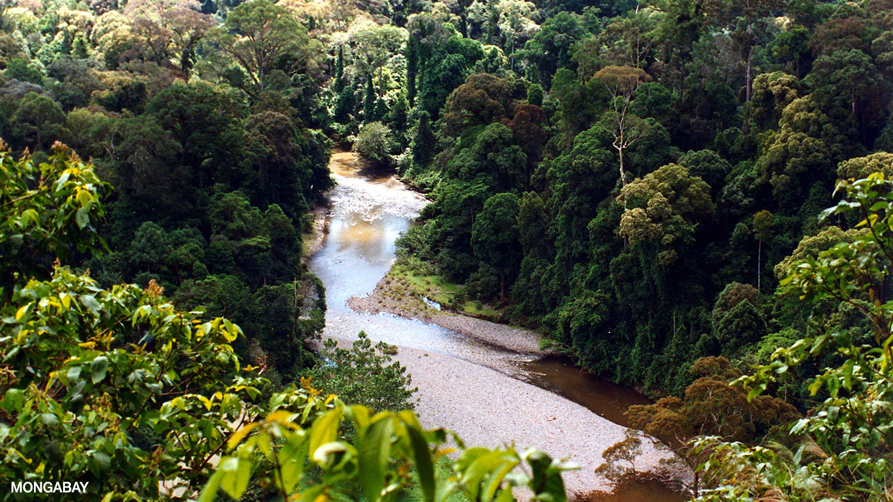
```

## Photosynthesis

- Photosynthesis feeds the living world
- Two modes of energy conversion:
  - Autotrophs: inorganic nutrients and energy (light = photoautotrophs)
  - Heterotrophs: consume other organisms

## Photoautotrophs

- Plants
- Algae
- Some protists (unicellular eukaryotes)
- Cyanobacteria
- Purple sulphur bacteria
- Animals?

## *Elysia chlorotica* {.flex-cols}

- Solar powered sea slug
- Consumes algae, retains chloroplasts in gut
- Absorbed into cells

```{r, out.width = "90%", fig.align='center'}
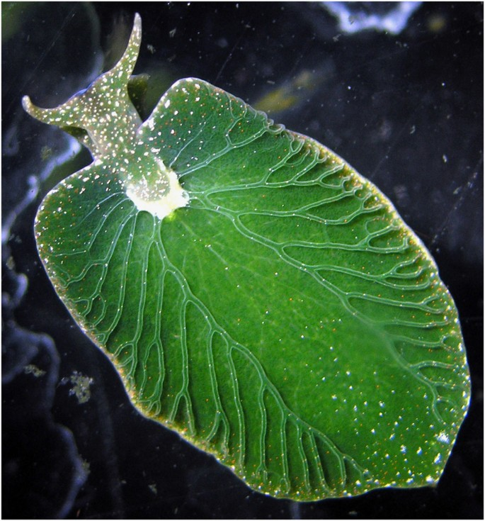
```

## *Ambystoma maculatum* {.columns-2}

- Only known photosynthetic vertebrate
- Algae present in oviducts of female
- Algae develops inside cells of embryo, powering mitochondria
- Occupies low O~2~ ponds without fish

```{r, out.width = "80%", fig.align='center'}
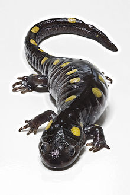
```

## Chloroplasts

- 500,000 per mm^2^ of leaf
- Packed into cells of mesophyll (30-40 per cell)
- Organelle has double membrane
- Inside is a dense fluid called the stroma
- Thylakoid sacs are suspended in the stroma, contain chlorophyll
- Absorbs blue and red light (appears green)

## Chloroplasts {.white-slide}

```{r, out.width = "90%", fig.align='center'}
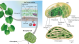
```

## Overview of the process

### Carbon dioxide + water + light → sugar + oxygen + water

### 6 CO~2~ + 12 H~2~O + light → C~6~H~12~O~6~ + 6 O~2~ + 6 H~2~O

... The reverse of respiration

## Chemical process (broadly)

- Water is split into H^+^ and O~2~
- H^+^ added to CO~2~ to make sugar
- O~2~ is the waste product
- Redox reaction:
  - CO~2~ is reduced to sugar (gains electrons)
  - H~2~0 is oxidised to O~2~ (loses electrons)

## Chemical process (in detail)

There are two processes:

**Light reactions**

- Convert light energy to chemical energy
- Occurs in the thylakoids

**Calvin cycle**

- Converts CO~2~ into sugar
- Occurs in the stroma

## Photosynthesis overview {.white-slide}

```{r, out.width = "75%", fig.align='center'}
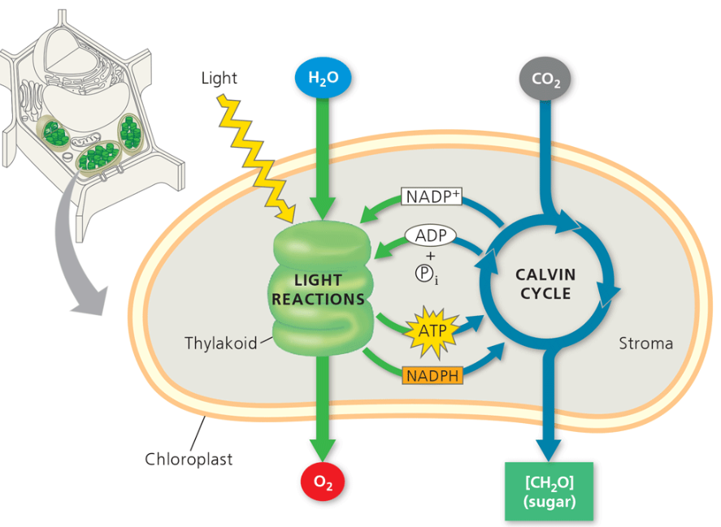
```

## Light reactions

- H~2~0 split into electrons and protons (H+)
- O~2~ is waste product
- 2 electrons and H^+^ added to electron acceptor NADP+ to make NADPH
- Phosphate group added to ADP to make ATP 

## Photosystems

- Light reactions take place in photosystems I & II, embedded in the thylakoid cell membrane
- Chlorophyll plus various molecules and proteins
- Reaction centre complex surrounded by light harvesting complexes
- Light harvesting complex contains the chlorophll
- Light photons boosts chlorophyll electrons to a higher orbit – triggering a “Mexican wave”

## Chlorophyll {.white-slide}

```{r, out.width = "65%", fig.align='center'}
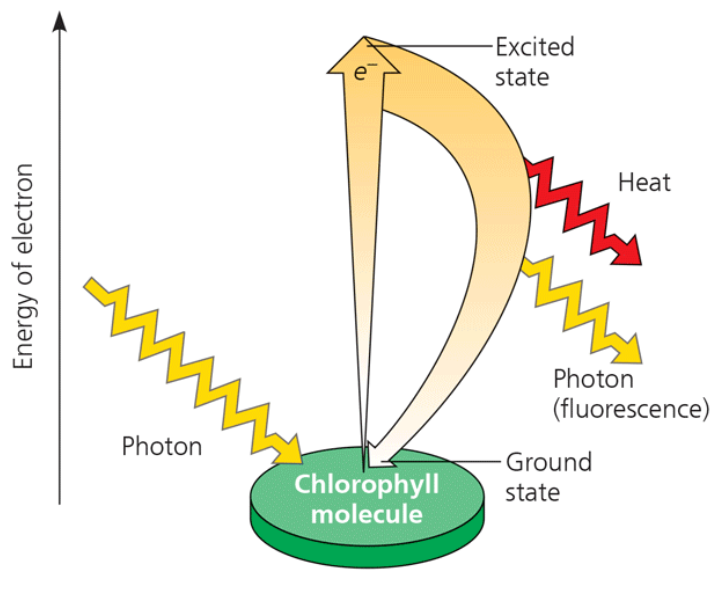
```

## Photosystem {.white-slide}

```{r, out.width = "55%", fig.align='center'}
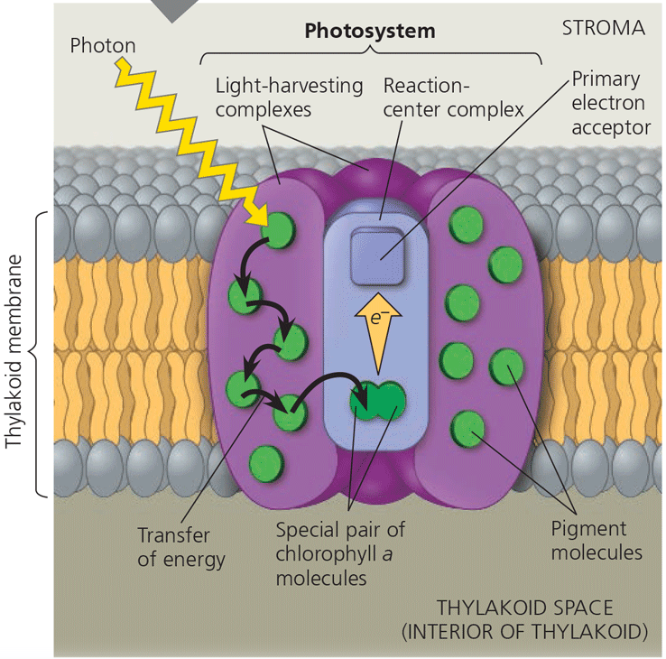
```

## Different forms of chlorophyll

```{r, out.width = "85%", fig.align='center'}

```

## Reaction centre complex

- Contains pair of chlorophyll a molecules
- Electrons excited to higher orbit and transferred to electron acceptor
- A redox reaction
- Light energy to chemical energy

## Photosystems I and II (PS I & PS II)

- 2 types of photosystem, differ in their electron acceptor and chlorophyll molecule
- PS II functions first!
- PS I chlorophyll P680 (absorbance at 680 nm) 
- PS II chlorophyll P700
- Systems works by the exitation and transfer of electrons 

## Photosystems I and II (PS I & PS II) {.white-slide}

```{r, out.width = "90%", fig.align='center'}
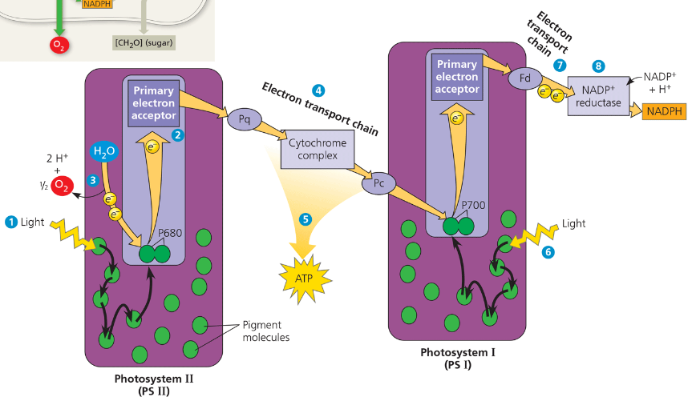
```

## Linear electron flow

1. Photon hits light harvesting complex of PS II, “Mexican wave” to P680 chlorophyll in reaction centre complex
2. P680 transfers electron to electron acceptor
3. Enzyme splits H~2~O → 2e- 2H^+^ 1O. P680’s electron replaced. O2 formed as waste
4. Electron passes from electron acceptor along electron transport chain to PS I. Released energy pumps protons into thylakoid space
5. Potential energy of proton gradient converts ADP to **ATP** using chemiosmosis
6. Light energy transferred to PS I reaction centre complex excites P700 chlorophyll, electron transferred to electron acceptor. P700 electron replaced by PS II electron transport chain
7. Electrons pass from PS I electron acceptor to a second electron transport chain 
8. Two electrons are added to NADP+ to make **NAPDH**

## Linear electron flow {.white-slide}

```{r, out.width = "90%", fig.align='center'}

```

## Linear electron flow {.white-slide}

```{r, out.width = "70%", fig.align='center'}
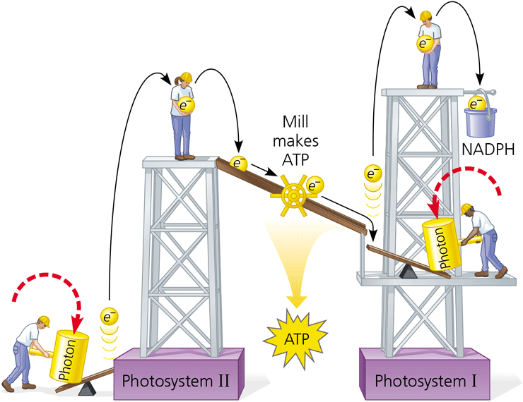
```

---

```{r, out.width = "100%", fig.align='center'}

```

## Calvin cycle

- Converts CO~2~ carbon into sugar
- Uses ATP (energy) generated in light reactions
- Makes 3 carbon sugar called glyceraldehyde 3-phosphate (G3P)
- Requires 3 CO~2~ molecules and 3 turns of the cycle
- 2 GP3s make glucose

## Calvin cycle {.white-slide}

```{r, out.width = "65%", fig.align='center'}
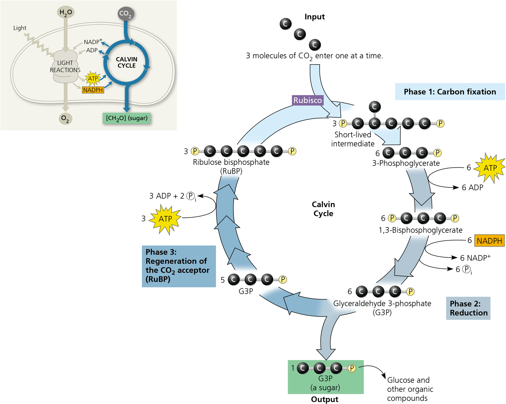
```

## Calvin cycle

**Carbon fixation**

- CO~2~ added to five-carbon sugar called ribulose bisphosphate (RUBP) by rubisco enzyme. Resulting 6-carbon sugar is unstable and splits into 2 3-phosphoglycerate (3-PGA) sugars

**Reduction**

- Phosphate added to 3-phosphoglycerate, using ATP, to make 1,3-biphosphoglycerate. 2 electrons added from NAPDH to make G3P. 1 out of 6 G3Ps exits the cycle

**Regeneration of RUBP**

- 5 G3Ps are rearranged into 3 RUBP molecules, using ATP

## Calvin cycle {.white-slide}

```{r, out.width = "65%", fig.align='center'}

```

## Net synthesis

- 3 CO~2~ + 3 RUBP → unstable sugar → 6 3-PGA
- **6 ATPs** add phosphate groups
- **6 NADPH** add electrons
- Product 6 G3Ps → **1 G3P** is released 
- **3 ATPs** rearrange 5 G3Ps into 3 RUBPs

### One G3P requires 9 ATPs and 6 NADPHs

## Challenges {.flex-cols}

- Stomata allow gas exchange in/out of leaf
- Also main cause of water loss
- Closing stomata starves system of CO~2~
- O~2~ enters the calvin cycle: photorespiration
- Causes release of CO~2~ and produces no sugar

```{r, out.width = "70%", fig.align='center'}
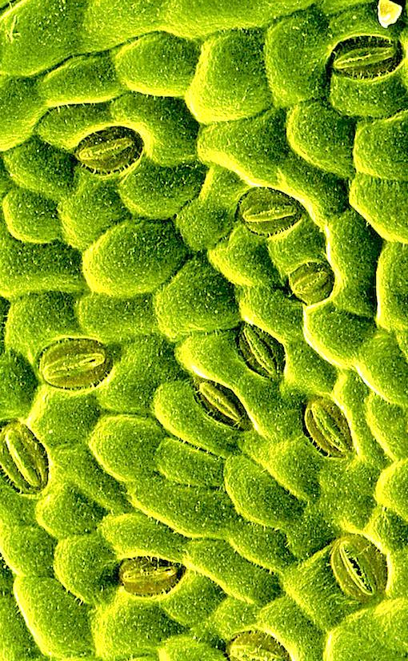
```

## C4 pathway

- Uses 4 carbon compound as initial product
- As opposed to 3 carbon system (C3 pathway)
- PEP carboxylase adds CO~2~ to PEP to form four-carbon oxaloacetate, uses ATP
- Low affinity for O~2~ and works at low CO~2~ concentrations
- Evolved 45 times independently

## C4 plants

- Corn
- Sorghum
- Sugarcane
- Millet
- Maize
- Many tropical grasses
- **25% of world’s vegetation**

## C4 plants {.white-slide}

```{r, out.width = "65%", fig.align='center'}
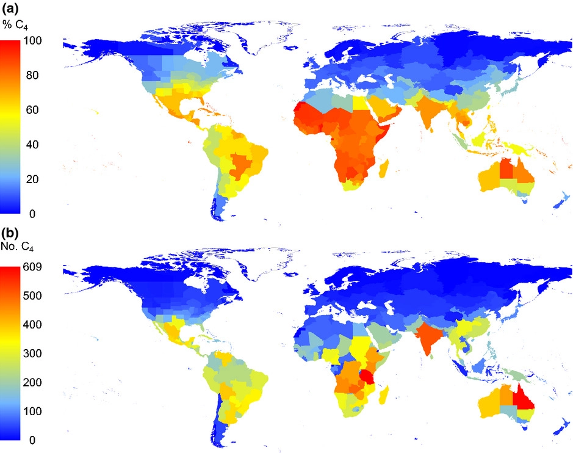
```

## C4 plants

```{r, out.width = "95%", fig.align='center'}
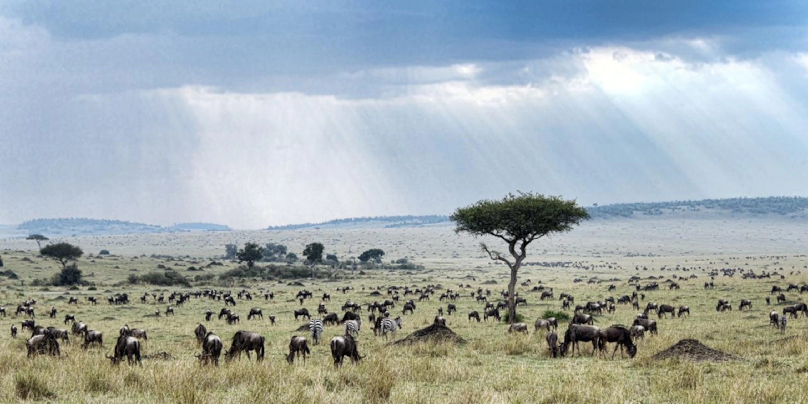
```

## C4 plant evolution in Africa {.columns-2}

- C4 pathway evolved ~35 Ma
- Started expansion in Africa ~ 10 Ma
- Coincided with a dip in atmospheric CO~2~
- Transition of C3 forests to C4 savannah
- Evolution of large mammal fauna
- … and early Homininae leading to hominins

```{r, out.width = "100%", fig.align='center'}
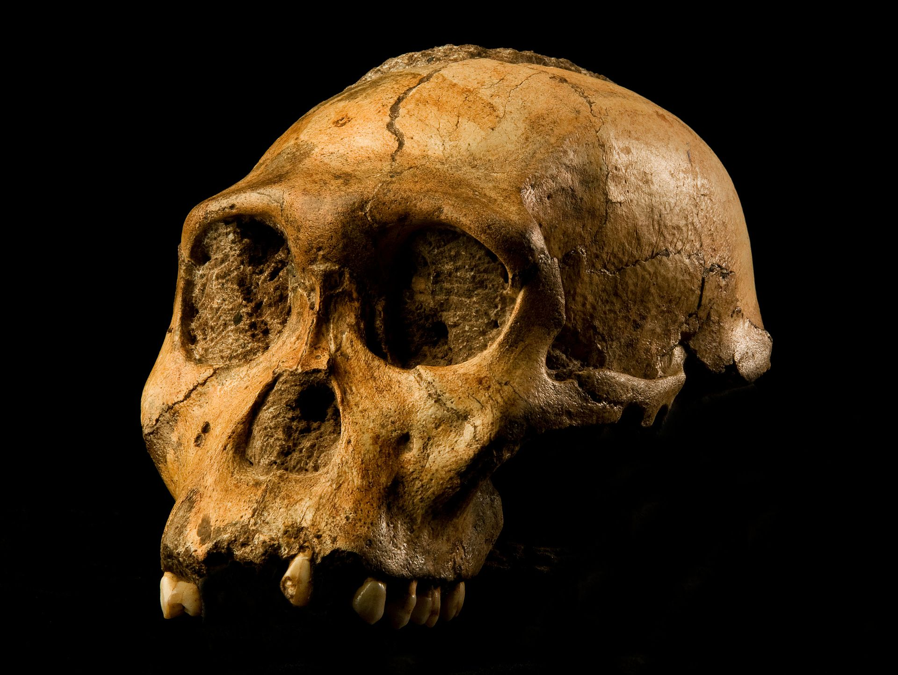
```

## Assessment

### MCQ Exam

- MCQ units 1 (chemistry) and 2 (cell biology)
- Drop in session
- 40% module mark

### Practical: Mitosis in onion root tips

- Dr. Owen Osbourne
- Lab practical report

# Good luck in the exam!

### Dr. Axel Barlow: a.barlow@bangor.ac.uk
